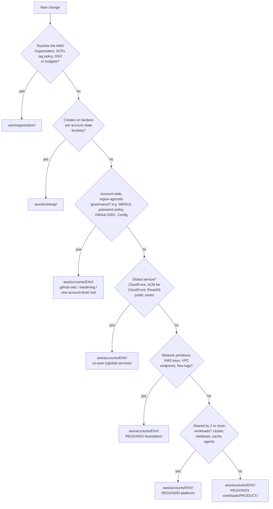

# AWS infrastructure

Entry point for anyone changing the AWS estate. Its job is to answer **"my
change goes where?"** in under five minutes.

The tree is sliced three ways:

- **Account**: management / production / staging / sandbox
- **Region**: the primary workload region (`eu-west-1` in this checkout), plus
  `us-east-1` for global services and account-level roots
- **Tier**: `01-foundation` / `02-platform` / `03-workloads` inside each region

## Where does my change go?



Still unsure? Use the heuristic at the end of [the 3-tier pattern](#the-3-tier-pattern).

## Repository layout

```
aws/
├── organization/          # Management-account org config (OUs, accounts, SCPs, SSO, budgets)
├── bootstrap/             # Per-account S3 state buckets (one-shot, scripts/bootstrap.sh)
├── policies/
│   ├── scp/               # SCP JSON consumed by organization/
│   └── tag/               # Tag policy JSON consumed by organization/
└── accounts/
    ├── management/        # Account-level roots only (no workloads)
    ├── production/
    ├── staging/           # The reference environment: every tier has an example
    └── sandbox/
```

`us-east-1/global-services/` roots don't exist yet; create one when you need
CloudFront, its ACM certificates, or public Route53 zones
(`scripts/new-root.sh` doesn't scaffold them because the path has no tier:
copy an account-level root and adjust its backend key).

Conventions that span every root:

- [`SECRETS.md`](SECRETS.md): Secrets Manager naming.
- [Naming](#naming) and [tags](#tags) below.

## Account model

| Account | OU | Purpose |
|---|---|---|
| Management | (root) | Org control plane only, no workloads. OUs, SCPs, SSO, budgets, the management CI role, and the state for organization/, bootstrap/, datadog/ and github/. |
| Production | Workloads | Live workloads. Strict SCP. |
| Staging | Workloads | Pre-production with production's governance. |
| Sandbox | Sandbox | Experimentation. Baseline + require-tags SCP, budget-capped. |

Accounts are created by [organization/](organization/) from
`organization/terraform.tfvars`; account IDs are its `account_ids` output.

## The 3-tier pattern

Inside every `aws/accounts/<env>/<region>/` there are up to three numbered
directories. The numbers force a sort order, so CI applies foundation before
platform before workloads.

| Tier | Lifecycle | Owner | What lives here |
|---|---|---|---|
| `01-foundation` | Set up once, changes rarely | Platform team | Network primitives + encryption keys |
| `02-platform` | Changes when shared infra evolves | Platform team | Clusters, databases, caches, agents |
| `03-workloads/<product>` | Changes every product release | Product team | One directory per product |

Dependency direction: **workloads → platform → foundation**. Higher tiers read
lower ones via `terraform_remote_state` in `data.tf`. Lower tiers never read
higher ones.

### 01-foundation

Everything every workload in the region depends on, created *before* any
compute or data plane. The example
([staging](accounts/staging/eu-west-1/01-foundation/),
[production](accounts/production/eu-west-1/01-foundation/)) has:

- KMS CMKs per data class (`ebs`, `rds`, `s3`, `general`, `logs`), rotated yearly.
- VPC with public / private / database subnets across pinned AZs.
- NAT: one gateway in staging (cost), one per AZ in production (HA).
- VPC flow logs to a KMS-encrypted CloudWatch log group.
- S3 gateway endpoint (free). Add interface endpoints when NAT data charges justify them.

State key: `<region>/01-foundation/terraform.tfstate`.

### 02-platform

Infrastructure that *multiple* workloads share. Reads foundation outputs. The
[example](accounts/staging/eu-west-1/02-platform/) is an ECS Fargate cluster
(no cost while idle) with audited ECS exec. Typical real contents: an EKS
cluster, Aurora, a cache, a shared load balancer, observability agents.

State key: `<region>/02-platform/terraform.tfstate`.

### 03-workloads/`<product>`

Things owned by a single product. One directory per product. Reads foundation
and platform. The
[example-app](accounts/staging/eu-west-1/03-workloads/example-app/) has an ECR
repository, a data bucket, a Secrets Manager secret, a log group and the IAM
task role. Copy it to onboard a product, and add the product name to the
`Product` values in [policies/tag/required-tags.json](policies/tag/required-tags.json).

State key: `<region>/03-workloads/<product>/terraform.tfstate`.

### Not sure which tier?

- If your change would **survive deleting every product** in the account, it
  belongs in `01-foundation` (network/key primitive) or `02-platform`
  (data/runtime plane).
- If it would **break one product but not another**, it belongs in that
  product's `03-workloads/<product>/`.

## Regional vs account-level directories

| Directory | Scope | Why not inside a region? |
|---|---|---|
| `<env>/<region>/` | Per region | Workload regions |
| `<env>/us-east-1/global-services/` | Global resources | CloudFront, its ACM certs, public Route53, CloudFront WAF must live in `us-east-1`. No VPCs. |
| `<env>/github-oidc/` | Account-wide | One OIDC provider + CI role per account |
| `<env>/hardening/` | Multi-region, one root | Account-wide password policy and S3 public access block, plus per-region defaults via provider aliases |

When in doubt: if Terraform needs **provider aliases** (several regions in one
root), the directory is account-level. If everything is in one region, it goes
under that region.

## State backend

One S3 bucket per account, all in `us-east-1`, named `<prefix>-tfstate-<env>`:
the management bucket is created by `scripts/bootstrap.sh`, the member buckets
by [bootstrap/](bootstrap/) (each with its own CMK). The key mirrors the
directory below the account: `aws/accounts/staging/eu-west-1/01-foundation/`
uses `key = "eu-west-1/01-foundation/terraform.tfstate"`.

Locking uses **S3 native locking** (`use_lockfile = true`, Terraform 1.10+):
no DynamoDB table. Buckets are versioned (90 days of history), KMS-encrypted,
public-access-blocked and TLS-only.

## Per-root files

| File | Contents |
|---|---|
| `backend.tf` | S3 backend. `use_lockfile = true`. Key per the convention above. |
| `providers.tf` | `terraform { required_version, required_providers }` + provider config with the mandatory `default_tags`. Multi-region roots declare aliases here. |
| `variables.tf` | Inputs, each typed, described, validated where constrained. |
| `main.tf` (+ topic files) | Resources and module calls. |
| `outputs.tf` | Values other roots read via remote state. |
| `data.tf` | `terraform_remote_state` and other lookups. |
| `terraform.tfvars` | Environment-specific, **non-secret** values (committed). |
| `README.md` | What the root owns + the terraform-docs reference table. |

`scripts/detect-changes.sh` keys on `backend.tf` to find roots; a root with a
`.ci-skip` file is excluded from CI (document why inside it).

## Naming

Don't repeat what the context already says. The account implies the org and
environment's owner, the ARN carries the region:

| Resource | Example |
|---|---|
| VPC, ECS/EKS cluster | `staging` |
| KMS alias | `alias/staging-s3` |
| ECR repository | `<product>/<service>` (e.g. `example-app/api`) |
| IAM role (workload) | `<product>-<service>-task` |
| Log group | `/ecs/<cluster>/<product>/<service>` |
| Secret | see [SECRETS.md](SECRETS.md) |

**S3 buckets are the exception**: their names are globally unique across all
AWS accounts, so they carry the org prefix and environment:

```
<prefix>-<env>-<product>-<usecase>      # e.g. acme-staging-example-app-data
<prefix>-tfstate-<env>                  # state buckets
```

## Tags

Every AWS root's provider sets six mandatory `default_tags`:

```hcl
ManagedBy   = "terraform"                # constant
Repository  = "<owner>/<repo>"           # constant
Environment = "<env>"                    # management | production | staging | sandbox
Region      = "<region>"                 # the provider block's region
Product     = "<product>"                # a product name, or shared
Tier        = "<tier>"                   # foundation | platform | workloads | governance | organization | bootstrap
```

| Root | `Product` | `Tier` |
|---|---|---|
| `<region>/01-foundation` | `shared` | `foundation` |
| `<region>/02-platform`, `us-east-1/global-services` | `shared` | `platform` |
| `<region>/03-workloads/<product>` | `<product>` | `workloads` |
| `github-oidc`, `hardening`, other account-level roots | `shared` | `governance` |
| `aws/organization` | `shared` | `organization` |
| `aws/bootstrap` | `shared` | `bootstrap` |

Owner isn't tagged: it's derived from `Tier` (foundation/platform: platform
team; workloads: the product team). Tag keys are case-sensitive.

**Three enforcement layers:**

- **CI / pre-commit**: [`scripts/check-required-tags.sh`](../scripts/check-required-tags.sh)
  fails the build if any AWS provider's `default_tags` is missing a key.
  tflint/checkov inspect resource HCL and don't see `default_tags`.
- **SCP, tag presence**: [`policies/scp/require-tags.json`](policies/scp/require-tags.json)
  denies tag-on-create services (EC2/EBS, RDS, ECR, ElastiCache) without a
  `Product` tag. Rolled out to the Sandbox OU first (`require_tags_scp_ous`);
  add `workloads` once validated. `s3:CreateBucket` is excluded: the S3 API
  can't carry request tags.
- **Tag policy, values (report-only)**: [`policies/tag/required-tags.json`](policies/tag/required-tags.json)
  pins allowed `Product` / `Tier` / `Environment` values and casing; violations
  show in the Organizations tag-policy compliance report.

**Cost allocation**: activate `Product`, `Tier` and `Environment` as
cost-allocation tags in the management account's Billing console so they
appear in Cost Explorer and the CUR.

## CIDR plan

One `/16` per account per region. Keep the second octet aligned across
regions (`10.0` ↔ `10.10`) so peering or a Transit Gateway later needs no NAT.

| Account | Primary region | Second region (reserved) |
|---|---|---|
| Production | `10.0.0.0/16` | `10.10.0.0/16` |
| Staging | `10.1.0.0/16` | `10.11.0.0/16` |
| Sandbox | `10.2.0.0/16` | `10.12.0.0/16` |
| Azure staging | `10.101.0.0/16` | |

Inside each `/16`: one `/20` (4,096 IPs) per tier per AZ, with slots for three
AZs reserved per tier (see the table in each foundation `main.tf`).

## Modules

Prefer the official [terraform-aws-modules](https://github.com/terraform-aws-modules)
over raw resources when one fits, pinned with `~> X.0`. Your own reusable
modules belong in a **separate, versioned repository** (no local `modules/`
dir), consumed by tag:

```hcl
module "service" {
  source = "git::https://github.com/<owner>/terraform-modules.git//modules/service?ref=service/v1.2.0"
}
```

A module change then reaches a root only when that root bumps its `?ref`:
staged rollout (staging first) and a clear record of what runs where. CI reads
private module repos through a GitHub App token (SETUP.md step 12). Locally,
SSH users can run
`git config --global url."git@github.com:<owner>/".insteadOf "https://github.com/<owner>/"`.

## Developer flow

1. Edit a root (or scaffold one with `scripts/new-root.sh`).
2. `pre-commit run --all-files`, push a branch, open a PR.
3. CI runs the guardrails and posts a `terraform plan` per affected root.
4. Review the plans; resolve drift or unexpected diffs.
5. After approval, comment `terraform apply <dir>` per root, lowest tier
   first. The apply output is posted back.
6. Merge once every affected root is applied green.

CI authenticates with per-account GitHub OIDC roles
(`AWS_ROLE_<ENV>` secrets hold the ARNs). No static AWS credentials anywhere.
